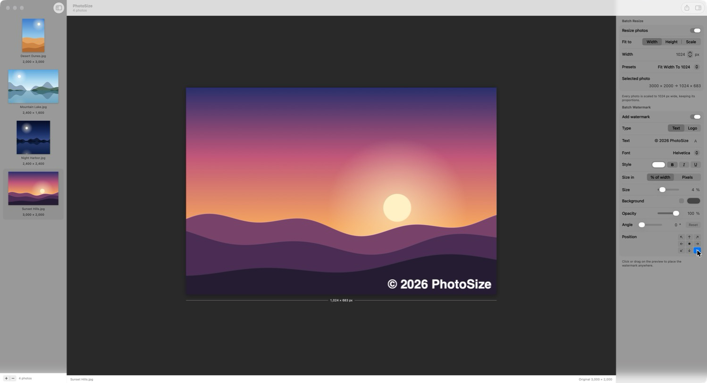
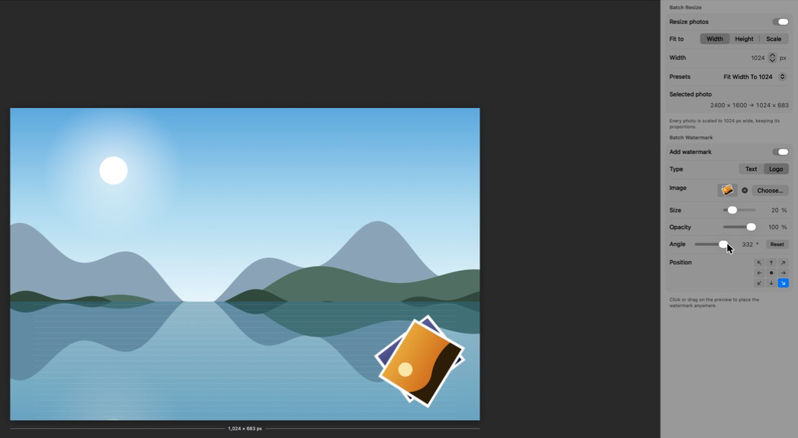
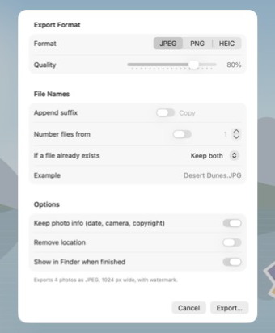

<p align="center">
  
</p>

<h1 align="center">PhotoSize</h1>

<p align="center">
  Batch-resize and watermark photos on your Mac.<br>
  Drop in a folder of photos, choose a size and a watermark, and export them all at once.
</p>

<p align="center">
  
</p>

## Features

- **Batch resize:** fit every photo to a width, a height, or a percentage of its size, with one-click presets. A warning appears when a setting would enlarge a photo past its original size.
- **Text watermarks:** any font, colour, bold/italic/underline, opacity, rotation, and an optional background box. Size it in pixels or as a percentage of each photo's width, so it looks the same on a small web image and a 24-megapixel photo.
- **Logo watermarks:** use any image (PNGs with transparency work best), sized as a percentage of each photo's width.
- **Place it anywhere:** snap to one of nine positions, or click and drag on the preview.
- **What you see is what you get:** the preview is drawn by the same code as the export, so they always match.
- **Export to JPEG, PNG or HEIC,** with a quality setting, an optional suffix and numbering, and a choice to keep or replace existing files.
- **Keeps your photo info:** date, camera, copyright and colour profile carry over, with an option to remove location data.
- **Respects rotation:** portrait photos from phones come out upright.
- **Fast:** photos are processed in parallel, with progress and a Stop button.
- **Private:** everything happens on your Mac. PhotoSize makes no network connections.

| Watermark | Export |
| --- | --- |
|  |  |

## Requirements

- **To run:** macOS 14 Sonoma or later, on Apple silicon or Intel. HEIC export appears only on Macs that can encode HEIC.
- **To build:** Xcode 27 or later. The project uses Xcode's newer JSON project format (`PhotoSize.xcodeproj/project.xcproj`), which older Xcode versions can't open.

## Building

```bash
git clone https://github.com/brian-sumpter/PhotoSize.git
cd PhotoSize
open PhotoSize.xcodeproj
```

Then press **⌘R** to run, or **⌘U** to run the tests. From the command line:

```bash
xcodebuild test -project PhotoSize.xcodeproj -scheme PhotoSize -destination 'platform=macOS'
```

The project signs to run locally, so you don't need a developer account to build it. To distribute your own build, set your team and change the bundle identifier (`com.emediadesigns.photosize2`) in the target's build settings.

## Using PhotoSize

1. **Add photos:** drag photos or whole folders onto the window, or choose **File ▸ Add Photos…** (⌘O). You can also drag photos straight out of the Photos app.
2. **Resize (optional):** in **Batch Resize**, turn on *Resize photos* and choose to fit a width, a height, or a scale percentage, or pick a preset.
3. **Watermark (optional):** in **Batch Watermark**, turn on *Add watermark*, choose *Text* or *Logo*, and adjust it. Click a snap position, or drag on the preview to place it.
4. **Export:** choose **File ▸ Export…** (⌘E) or the share button in the toolbar, set the format and file names, click **Export…**, and pick a folder.

Your settings are remembered between launches. Try it with the images in [`docs/sample-photos`](docs/sample-photos), which are generated and free to use.

### Keyboard shortcuts

| Action | Shortcut |
| --- | --- |
| Add photos | ⌘O |
| Export | ⌘E |
| Remove selected photos | ⌘⌫ (or Delete in the photo list) |
| Remove all photos | ⇧⌘⌫ |
| Show or hide batch settings | ⌥⌘I |

## Project layout

```
PhotoSize/
  Engine/       Image loading, resizing, watermark drawing and export. No UI; fully unit-tested.
  Model/        App state, importing photos, logo storage.
  Views/        SwiftUI views: drop zone, photo list, preview, inspector, export sheet.
PhotoSizeTests/ Swift Testing suite (engine, import, settings, window snapshots).
docs/           Architecture, porting notes, sample photos, README images.
```

See [docs/ARCHITECTURE.md](docs/ARCHITECTURE.md) for how the pieces fit together.

## History

PhotoSize began in 2015 as a Mac App Store app written in [Xojo](https://www.xojo.com), with a few
commercial plugins. Version 2.0 is a complete rewrite in Swift and SwiftUI that uses only Apple's
frameworks. It keeps the original's workflow and fixes several long-standing issues: sideways
portrait photos, lost metadata, and file names that could collide. [docs/PORTING.md](docs/PORTING.md)
covers what was kept, fixed and dropped.

## Contributing

Bug reports and pull requests are welcome. See [CONTRIBUTING.md](CONTRIBUTING.md) to get started,
or [open an issue](https://github.com/brian-sumpter/PhotoSize/issues).

## License

PhotoSize is released under the [MIT License](LICENSE).
